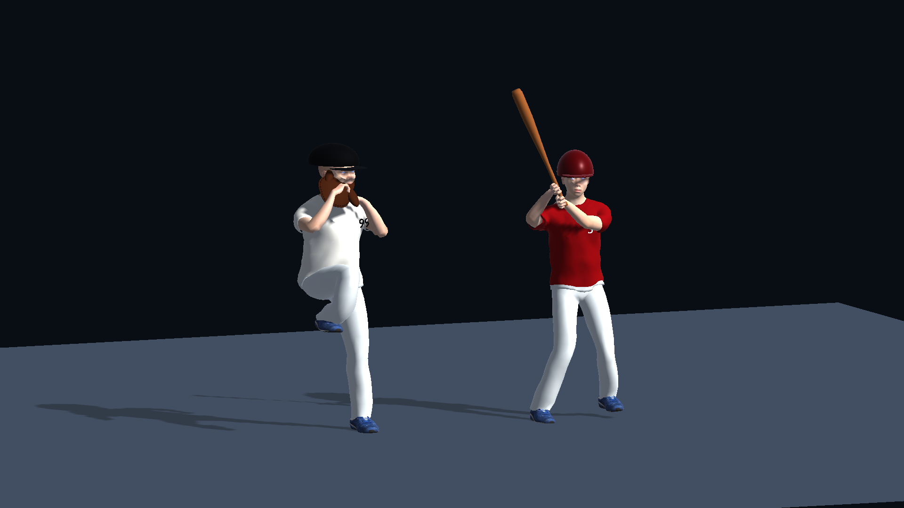
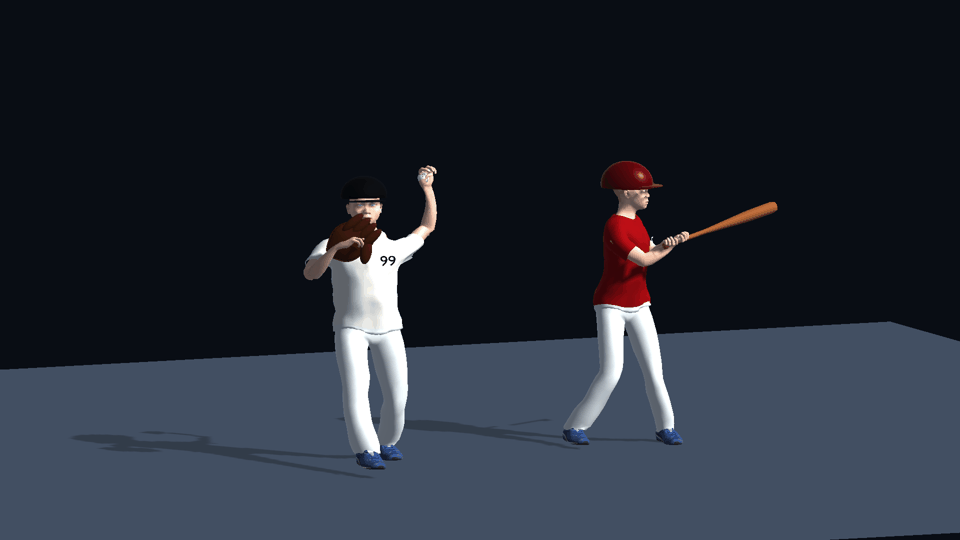
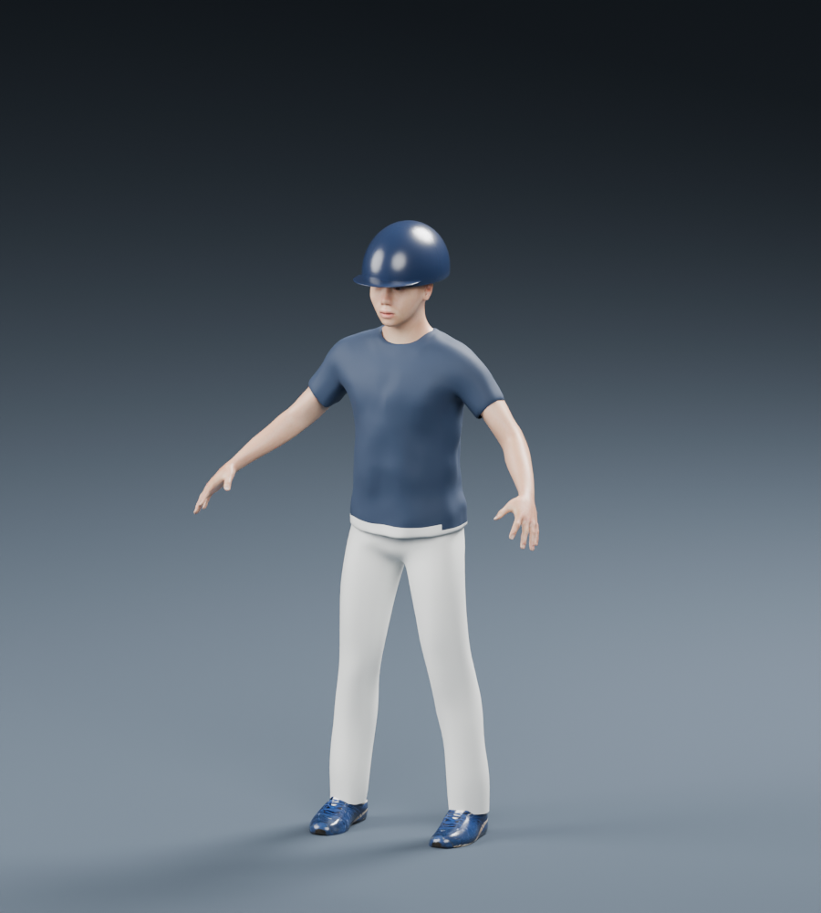

# Unity 타격 장면 품질 검증 준비

범위는 타자1명·투수1명·경기장1곳입니다. 기존 Android 시제품과 별도 프로젝트입니다.

**현재 상태: 무료 인체·의복·눈과 163개 뼈대를 연결한 공통 선수 원형의 Blender 렌더까지 확인했습니다. 김도영·류현진의 체격/투타를 바탕으로 동작 초안을 추가했습니다. 실제 선수 얼굴과 고유 폼의 정밀 재현·경기장·새 APK는 아직 완성되지 않았습니다.**

## 준비한 것

- 설치된 Unity 6.6 6000.6.8f1 / 공식 템플릿 기준 URP17.6.0 설정 및 Pipeline0.10.0-exp.1 연결
- 실제 인체 프리팹·Animator·모션을 요구하는 에셋 바인딩
- 에셋이 연결된 뒤 타자/투수/구장과 중계 카메라·조명을 배치하는 Editor 도구 초안
- 실제 에셋과 엔진/시각 검증이 없으면 준비 완료로 판정하지 않는 점검 도구
- 공식 MakeHuman 저장소의 CC0 인체 원본·골격·가중치 확보. `asset-acquisition.json`에 고정 버전/해시/출처 기록. 이것은 옷을 입고 모션이 적용된 완성 선수 모델이 아닙니다.

Unity 패키지 복원과 C# 컴파일은 확인했습니다. 엔진에서 FBX 피부 변형 모델·3초 이상 클립·손 뼈대 이동·피부 텍스처·바닥 재질 저장을 검사하는 EditMode 테스트 2건이 통과했습니다. 실제 Play 모드에서 프레임 증가와 모델 동작 변화도 확인했습니다. 기능 검증과 참고 이미지 수준의 품질 통과는 별개입니다.

## 엔진 설치 상태

Unity Hub 설치·로그인·Unity 6.6 (6000.6.8f1) 설치가 완료됐습니다. Android 제작에 필요한 Android Build Support는 아직 설치 목록에 없습니다. 현재 설치된 추가 모듈은 Web입니다.

## 선수별 동작 초안

대상은 KBO 공식 프로필의 김도영(183cm/85kg, 우투우타, 5번)과 류현진(190cm/113kg, 좌투우타, 99번)입니다. `player-profiles.json`에 출처와 확인일을 기록했습니다. 키 비율과 체격 폭을 구분했으며 체중은 신체 시뮬레이션으로 재현한 값이 아닙니다.

기존 인체 원형에 턱·볼 폭, 의상 색과 번호, 우타 스윙·좌완 투구 동작을 손으로 제작했습니다. 선수 얼굴은 아직 공통 원형에 가깝습니다. 관절 각도·타이밍은 사진을 참고한 제작자 추정이며 실제 선수의 모션 캡처/측정값이 아닙니다. 류현진은 과거 폼 참고가 포함돼 정확한 2026년 폼으로 검증하지 않았습니다. 유사도 승인 전까지 고유 폼 재현 완료로 표시하지 않습니다. 글러브는 포켓·테두리·끈·손가락 패드를 갖춘 자체 제작 초안으로 교체했습니다. 실물 장비 수준의 세부 재현은 미완성입니다.

`Tools/build_player_review.py`를 Blender에서 실행하면 97프레임(30fps, 3.2초)의 골격 동작을 굽고 FBX로 내보냅니다. 입력은 로컬의 기존 `GenericAthlete.blend` 또는 제작 캐시 `athlete-uniform.blend`입니다. 출력 원본은 `SourceArt/Players/`, Unity에 넣는 파일은 `Assets/Showcase/Art/Players/`의 FBX입니다. Blender 원본은 Unity 임포터가 별도 Blender 설치를 찾지 않도록 Assets 바깥에 보관합니다.

Unity 메뉴 `DeckBall > Player Study > Build`는 두 선수의 움직이는 모델과 조명·카메라만 갖춘 검토 장면을 만듭니다. 구장이나 플레이 가능한 경기 시스템은 포함하지 않습니다. `Capture`는 현재 장면의 실제 엔진 이미지를 `Reports/player-study-unity.png`에 저장합니다. 게임 완료 여부를 판단하는 기존 품질 게이트는 계속 별도로 유지합니다.





위 GIF는 실제 Unity Play 모드를 약 10초 동안 변동 간격으로 캡처해 만든 검토 자료입니다. 캡처 간격이 일정하지 않아 게임의 목표 프레임률을 보여주는 영상은 아닙니다. 프레임 증가 증거는 `Reports/player-runtime-frame-check.json`, 시각별 캡처 기록은 `Reports/player-runtime-capture.json`, Blender의 손 목표 오차는 `Reports/player-equipment-validation.json`에 있습니다. 기존 `player-motion-validation.json`은 28bb175 시점의 이전 자료로 표시했습니다. 이 검사는 참고 사진 수준의 외형이나 선수별 폼 유사도를 승인하지 않습니다.

검토 중 발견해 수정한 항목: 팔 도달 범위를 벗어난 투구 목표, 발목 방향, 배트 길이, 글러브 크기, 모자/머리 간섭, FBX 피부·신발 텍스처 누락, 카메라 뒤쪽 촬영, 바닥 재질 미저장. 기존 장면 변경 전 저장·취소 확인을 적용했고, 테스트는 수정 중인 기존 장면이 있거나 로컬 아트가 없으면 건너뜁니다. 무료 에셋 본체와 Blender 원본은 Git 제외 상태로 이 PC에만 있습니다.


## 이번에 만든 모델 원형



이 이미지는 Blender에서 실제 3D 모델을 렌더한 결과이며 Unity 플레이 화면이 아닙니다. 특정 KBO 선수의 얼굴을 재현하지 않았습니다. 기본 의복을 남색 상의와 흰 바지로 바꾸고 헬멧 원형을 추가했지만 야구복의 단추·팀 문양·봉제선·벨트와 장비 디테일은 미완성입니다. 헬멧 귀 보호대, 장갑, 배트, 구장과 경기 모션도 남아 있습니다. 참고 이미지 수준 검토는 통과하지 않았습니다.

로컬 원본: `SourceArt/Source-GenericAthlete.blend` (텍스처 내장), `Assets/Showcase/Art/Source/GenericAthlete.fbx` (골격 포함 내보내기). 두 파일은 Art 제외 규칙에 따라 Git에 올라가지 않습니다. 아직 Unity 임포트와 FBX 재임포트 시 외형·골격 유지 검증은 하지 않았습니다. 출처·해시는 `asset-acquisition.json`에 기록했습니다.

## 에셋 제작/연결 순서

1. MakeHuman 원본에 피부·눈·야구복을 만들거나 적합한 무료 에셋을 연결합니다.
2. 타격/투구 모션을 리타기팅하고 손-배트 부착, 공의 릴리스/접촉 프레임을 맞춥니다.
3. 실제 구장 모델·재질을 준비하고 아래 프리팹 이름으로 저장합니다.
4. Unity에서 URP 렌더 파이프라인을 구성합니다.
5. `DeckBall > Quality Shot > Create Asset Bindings`를 실행하고 프리팹과 모션을 배정합니다.
6. `Build Visual Review Scene`으로 정적 배치 초안을 만듭니다. 이 도구는 재생 가능한 타격 시스템을 완성하지 않습니다.
7. 실제 엔진 1920×1080 스틸과 10초 동영상을 기준 이미지와 비교합니다. 이 검증을 통과하기 전에는 품질 개선 완료로 부르지 않습니다.

`Assets/Showcase/Art/`에는 Batter.prefab, Pitcher.prefab, Stadium.prefab, Bat.prefab, Ball.prefab을 사용합니다. 에셋 본체는 별도로 보관하며 기본 Git 추적에서 제외했습니다.

## 테스트

```powershell
python -m pytest tests/test_baseball_showcase.py tests/test_player_motion.py -q
python unity-baseball-showcase/Tools/validate_assets.py
```

현재 점검 결과 `not_ready`가 정상입니다.

## 무료 후보 검토

- MakeHuman 코어 그래픽: https://www.makehumancommunity.org/about/license.html — CC0. 인체 원형으로 사용 가능하나 야구복·피부·모션 작업 필요.
- 무료 Animated baseball player: https://sketchfab.com/3d-models/animated-baseball-player-6b39fcafd2204b9fa9317f7b926807df — API 조회1051 vertices /1950 faces. 목표인 실사에 가까운 표현에는 부적합해 채택하지 않았습니다.
- Poly Haven: https://polyhaven.com/ — 환경광·표면 재질 후보. 아직 내려받거나 품질 검증하지 않았습니다.
- Mixamo: https://www.mixamo.com/ — 야구 모션 검토 후보이며 Adobe 로그인과 실제 클립/라이선스 확인이 필요합니다. 아직 확보하지 않았습니다.

유료 상품은 구매하거나 연결하지 않았습니다. 기존 `android-baseball/DeckBall.apk`는 이번 작업에서 변경하지 않았습니다.

엔진에서 실제 시각/모션 검토를 마친 뒤에만 바인딩의 해당 검토 필드를 체크하고 `Write Readiness Report`를 실행합니다. 자동 구조 점검과 두 검토가 모두 통과해야 Python 도구가 준비 완료로 판정합니다. 현재는 셋 모두 미완료입니다.

Unity 테스트는 Test Runner의 EditMode에서 `PlayerStudyTests.ImportedPlayersHaveSkinningAndMovingAnimation`을 실행합니다. 로컬 모델/텍스처와 저장된 기존 장면이 필요합니다. 초기 테스트는 도구 부재로 실패했고, 도구 추가 후 통과했습니다. 피부 텍스처·바닥 저장 회귀 검사도 실패를 확인한 뒤 수정했습니다.

## 손·장비 연결 개선 (2026-11-06)

두 손과 배트가 하나의 손잡이 축을 사용하며 손목 회전과 손바닥 기준 오프셋을 함께 굽습니다. 97프레임 전체 손바닥 기준점과 손잡이 오차 검사를 추가했습니다. 이는 손가락 표면이 완벽하게 접촉한다는 시각 승인과는 다릅니다. 접촉 프레임의 손가락·팔 모양에는 추가 보정이 필요합니다.

투구 공은 왼손 기준점을 따라가다가 2.0초에 분리되고 이후 중력을 적용한 궤적으로 이동합니다. 속도 32m/s는 동작 확인을 위한 시제품 설정이며 류현진의 실제 측정 구속/구종 데이터가 아닙니다. 체격을 넓히는 변환이 공을 타원형으로 만들지 않도록 보정했습니다. 실제 공기저항·회전 변화·구종·타격 판정·포수 포구는 아직 연결하지 않았습니다.

Python 검사 15건과 Unity EditMode 검사 2건(텍스처/모션, 릴리스/공 지름)을 통과했습니다. Unity 공 검사는 기존 공 없는 모델에서 실패를 확인한 다음 새 모델을 연결해 통과했습니다. 장비 검사 도구는 Blender에서 `--python-exit-code 1 --python Tools/validate_player_equipment.py -- --art SourceArt/Players --output Reports/player-equipment-validation.json`으로 실행합니다.

## 10구 타격 챌린지 (2026-11-06)

현재 동작하는 장면은 `DeckBall > Diamond Challenge > Build`로 만듭니다. 로컬 선수 FBX와 폰트가 필요하며 Play 버튼으로 실행합니다. `Start Preview`는 Play 중 입문 난이도와 밀어치기를 선택하는 검토용 메뉴입니다.

- 자체 제작 연습 구장, 홈 뒤 시점, 양쪽 선수 카드, 점수판과 3×3 스트라이크 존 안내선.
- 입문·보통·도전 난이도, 10구 종료와 재도전, 연속 성공 보너스, 난이도별 최고 기록 저장.
- 터치 시작 순간 입력 처리, 0.10초의 스윙 접촉 시간, 정확도/파워 선택.
- 기본·밀어치기·당겨치기·내려치기 버튼 전환. 방향·탄도와 자체 제작 동작 변형이 함께 바뀝니다. 실제 김도영의 타법을 측정한 모션은 아닙니다.
- 타구 추적 시점, 땅볼 바운드, 구장 펜스 위치를 공유하는 홈런 표시, 자체 합성 타격음. 관중 녹음과 응원·해설은 미구현입니다.
- Unity GameView에 Galaxy S26 2340×1080 고정 해상도를 추가했습니다. 좌우 컷아웃·하단 여백은 가정한 수치로 자동 검사합니다. 실제 S26 기기 성능·터치 지연은 확인하지 않았습니다. 참고: https://org-sec-b2c.samsung.com/sec/smartphones/galaxy-s26/specs/

스트라이크 존은 연습용 고정 안내선입니다. 선수별 ABS 존·볼 판정이나 실제 9이닝 경기, 수비·포수·주루, 2026 전체 로스터, 스카우팅/특수 능력은 이 장면에 아직 연결하지 않았습니다. 현재 연습구 구속은 난이도용 설정이며 실제 선수 구종 데이터가 아닙니다.

`Reports/diamond-unity-tests.json`에 최신 엔진 검사 결과, `Reports/swing-style-validation.json`에 97프레임 손잡이 연결 검사 결과가 있습니다. 이전 선수 스틸/GIF는 당시 검토 기록입니다. 새 타격 장면 캡처와 혼동하지 마세요. 참고 사진 수준의 실사 표현과 선수 닮은꼴 검토는 통과하지 않았습니다.

폰트는 Noto Sans KR의 정적 파생본 DeckBallKorean이며 OFL 고지문을 StreamingAssets에 포함합니다. Art/SourceArt 본체는 Git 제외 대상이므로 이 저장소만 복제하면 곧바로 실행되지는 않습니다. Android Build Support 미설치로 이번 Unity APK는 만들지 않았고, 기존 `android-baseball/DeckBall.apk`도 이번 변경을 포함하지 않습니다.

## 한 이닝 승부 시제품 (진행 중)

메뉴에서 한 이닝 승부/10구 챌린지를 선택합니다. 한 이닝은 공격만 진행하며 3아웃에 종료됩니다. 볼·스트라이크, 삼진, 볼넷의 강제 진루, 안타·장타의 보수적인 진루 및 득점을 연결했습니다. 10구 제한과 최고 기록은 별도 모드로 유지합니다.

수비는 연습 수비수 7명과 투수의 도착 시간, 포구 가능 높이, 송구 시간과 주루 시간을 비교하는 초기 모델입니다. 주자와 수비수는 현재 같은 원형 모델을 재사용하는 위치 이동 초안이며 정식 달리기/송구/슬라이딩 모션이 아닙니다. 모든 주자가 안타의 루타 수만큼 진루하는 단순화가 있으며 병살·야수 선택·태그업·실책·도루·희생타·자동 투구 제한은 미구현입니다. 파울 규칙 단위 검사는 있으나 플레이 중 파울 타구는 아직 연결하지 않았습니다. 실제 KBO 수비 기록으로 보정한 결과도 아닙니다.

기본 규칙 참고: https://www.mlb.com/glossary/standard-stats/strikeout , https://www.mlb.com/glossary/standard-stats/walk . KBO 2026 전체 규칙 적합성 승인을 뜻하지 않습니다.

## 선수 선택·능력치·특수 능력 (Unity 연결)

시작/결과 화면의 선수 관리 버튼에서 기존 안드로이드 시제품의 기록 스냅샷 33장(2026 카드 18장·역대 카드 15장)을 선택합니다. 2026 전체 선수 명단은 아니며 2026-11-04 조회본을 사용합니다. 원본 기록 문자열·출처와 환산 컨택은 편집 값과 분리됩니다. 컨택·파워·제구는 1~99, 특수 능력은 역할에 맞게 최대 2개입니다. 수정 값과 선택 선수는 별도 Unity 저장 키로 저장합니다. 예전 APK의 저장 파일을 자동 이전하지는 않습니다.

정교(+6 컨택), 거포(+8 파워), 해결사(득점권 컨택+10), 정밀 제구(+8 제구), 아우라(능력치+3)는 실제 선수의 공식 평가가 아닌 게임용 선택 항목입니다. 보너스 적용 상한은110입니다. 컨택은 타격 허용 시간, 파워는 타구 속도, 제구는 한 이닝 모드의 볼 발생 확률에 반영합니다. 실측 물리 모델이 아닌 균형 조정용 환산입니다.

선수 카드의 3D 그림과 경기 모델은 공용 원형입니다. 선택 선수의 얼굴·체형·좌우 타격/투구폼·유니폼을 재현하지 않습니다. 기존 모델 원본의 자세를 데이터 선택 선수의 고유 동작으로 간주하지 마세요. 스카우팅/구단 예산은 아직 Unity 화면에 연결하지 않았습니다.
